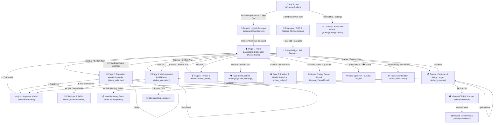

# OmniTask OS — Master Button-to-Button Sitemap & Interactive Flow

> **Version:** 2.4 Pro  
> **Architecture:** Responsive Cross-Platform (Mobile Phone, Tablet, Laptop, Desktop)  
> **Status:** Production Ready & Verified (0 missing functions, 0 missing DOM IDs)  

---

## 1. System Navigation Architecture & Screen Flow

---

## 2. Exhaustive Button-to-Button Matrix (17 Functional Screens & States)

### Gateway & Authentication
| # | Screen Name | DOM Container | How to Arrive (Incoming Buttons) | Outgoing Buttons & Actions |
|---|---|---|---|---|
| **0** | **Login & Persona Gateway** | `#loginScreen` | • Top simulation banner: `🚪 Switch Account / Login Gateway` • User profile menu: `🚪 Sign Out / Switch User` | • `🚀 Continue as Guest` ➔ Enters Dashboard (Page 1) as Guest • `🔑 Access Vault & Dashboard` ➔ Enters Dashboard in selected persona • Persona cards (`👤 Aswin`, `👵 Eleanor`, `🛡️ John`) ➔ Switches active profile |

---

### Primary Tab Pages (The 7 Core Views)
| # | Screen Name | DOM Container | How to Arrive (Incoming Buttons) | Outgoing Buttons & Actions |
|---|---|---|---|---|
| **1** | **Home Dashboard & Centerpiece Calendar** | `#view_home` | • Sidebar: `Home` (`#sideBtn_home`) • Bottom nav: `Home` (`#mobBtn_home`) • Topbar logo brand click • Calendar page: `📅 View Dashboard Calendar` | • `◀` / `▶` ➔ Previous / Next Calendar Month • `Today` ➔ Snaps calendar to today • `Month` / `Week` / `Day` ➔ Toggles calendar view format • Calendar Day Cell ➔ Focuses date & slides agenda with `.timeline-swap` • `＋ Quick Add` ➔ Opens Speed-Dial Quick Ingestion Modal • `💊 Med Log` ➔ Switches to Medications Hub • `Pay Now` ➔ Switches to Expenses Hub • `Routine →` ➔ Switches to Fitness Hub • `View all →` ➔ Switches to Medications Hub • Bento Status Tiles ➔ Deep-links to Spend, Fitness, or Household |
| **2** | **Expanded Weekly Calendar** | `#view_calendar` | • Sidebar: `Calendar` (`#sideBtn_calendar`) • Bottom nav: `Calendar` (`#mobBtn_calendar`) | • `📅 View Dashboard Calendar` ➔ Jumps to Home Dashboard (Page 1) • `Today` ➔ Snaps view to today • `➕ Add Event` ➔ Opens Quick Ingestion Modal • Hourly event pills ➔ Deep-link to Medications, Expenses, or Fitness |
| **3** | **Medications & Prescriptions Hub** | `#view_reminders` | • Sidebar: `Medications` (`#sideBtn_reminders`) • Bottom nav: `Meds` (`#mobBtn_reminders`) • Hero button: `💊 Med Log` • Dashboard medications card: `View all →` | • `💊 Take Dose` ➔ Increments day count & triggers adherence sound • `✏️` (Pencil button) ➔ Opens Prescription Dose & Refill Editor Modal • `➕ Add Rx` ➔ Opens Quick Add Modal for Prescriptions • `↺ Undo` ➔ Reverts last taken dose |
| **4** | **Expenses & Budget Ledger** | `#view_expense` | • Sidebar: `Expenses & Bills` (`#sideBtn_expense`) • Bottom nav: `Spend` (`#mobBtn_expense`) • Today's spend card: `Pay Now` | • `✏️ Edit Monthly Salary` ➔ Opens Monthly Salary Setup Modal • `📷 Scan Bill` ➔ Opens Vision OCR Bill Scanner Modal • `➕ Add Bill` ➔ Opens Quick Ingestion Modal for Bills • Category pills (`All`, `Utility`, `Food`, `Travel`, `Household`, `Medical`) ➔ Filters ledger • `💳 Pay Now` ➔ Reconciles bill, records expense, and auto-links • `📷 View Photo` ➔ Opens High-Res Verified Receipt Viewer Modal • `💾 Export CSV` ➔ Generates and downloads `expenses.csv` |
| **5** | **Fitness & Habits Hub** | `#view_fitness` | • Sidebar: `Fitness & Habits` (`#sideBtn_fitness`) • Dashboard bento tile: `Fitness & Habits` • Motivational botanical card: `Routine →` | • `✓ Complete Workout` ➔ Marks workout done & increases weekly streak • `+1 Log` ➔ Increments emoji habit count & animates streak flame • `➕ Add Routine` ➔ Opens Quick Add Modal for workouts |
| **6** | **Household Oversight Command Center** | `#view_oversight` | • Sidebar: `Household` (`#sideBtn_oversight`) • Topbar: `Family Hub` (`#btnHeaderFamily`) • Scenic hero chips (`Eleanor Vance`, `John Vance`) • User profile dropdown: `🛡️ Household Oversight Hub` | • `📞 Call Eleanor` ➔ Connects caregiver phone bridge • `+ Add Member` ➔ Opens Family Circle Modal • Dignity controls ➔ Adjusts senior high-contrast typography |
| **7** | **Insights & Health Analytics** | `#view_insights` | • Sidebar: `Insights` (`#sideBtn_insights`) • User profile dropdown: `📋 Doctor Visit Summary (PDF)` | • `📄 Export Summary` ➔ Prepares and prints clinician PDF report • `💾 Export CSV` ➔ Exports full audit dataset |

---

### Specialized Persona Cockpit Modes
| Mode | Trigger | UI Manifestation |
|---|---|---|
| **Power User Mode** | Topbar pill `#btnRolePower` | Wide multi-column layout, interactive split calendar, quick ingestion tools, and advanced financial velocity meters. |
| **Senior Dignity Mode** | Topbar pill `#btnRoleSenior` | Hides complex multi-column bento grids; activates `#seniorTabletCockpit` with **24pt+ typography**, **56dp touch buttons**, giant pill cards, digital clock, **"🗣️ Read Schedule"** audio readout, and **"🔒 Pause Tracking"**. |
| **Caregiver Mode** | Topbar pill `#btnRoleCaregiver` | Activates `#caregiverBar` and `#caregiverTelemetryCockpit` with live compliance status, dose escalation ladders, and audit logs for Eleanor Vance. |

---

### The 9 Action & Tool Modals
| Modal Name | DOM ID | How to Trigger (Button) | Actions Inside Modal |
|---|---|---|---|
| **1. Speed-Dial Quick Ingestion** | `#quickAddModal` | `＋ Quick Add`, `➕ Add Event`, `＋ Add Rx`, `＋ Add Bill` | • Select domain (`Pill`, `Bill`, `Expense`, `Fitness`, `Habit`, `Appointment`) • Fill title, category, time, cost/dosage • `Save & Aggregate` ➔ Inserts into calendar and ledger • `✕` ➔ Dismisses modal |
| **2. Monthly Salary Setup** | `#salaryModal` | `✏️ Edit Monthly Salary` (Expenses Hub) | • Preset buttons (`$3,500`, `$5,000`, `$7,500`, `$10,000`) • Custom salary number input • `💾 Save Monthly Income` ➔ Recalculates burn velocity and surplus • `✕` ➔ Cancels |
| **3. Family Circle & PIN Settings** | `#familySettingsModal` | `Family Hub`, `+ Add Member`, `Family Circle (+)` | • Add/edit family members and roles • Set/change 4-digit Senior Dignity PIN • `💾 Save Family Hub Settings` ➔ Updates vault credentials • `✕` ➔ Closes modal |
| **4. Task / Event Cascade Editor** | `#editModal` | Calendar day item pencil icon | • Edit task title, domain, scheduled time • `💾 Save Changes` ➔ Updates aggregated event record • `🗑️ Delete Event` ➔ Removes task and frees schedule • `✕` ➔ Closes editor |
| **5. Prescription Dose & Refill Editor** | `#editDoseModal` | Prescription card pencil icon (`✏️`) | • `+1 Day`, `-1 Day` ➔ Manually corrects intake record • `+5 Total` ➔ Extends prescription duration • `Reset to Day 1` ➔ Restarts full 30-day bottle regimen • `💾 Update Dose Record` ➔ Recomputes radar warnings • `✕` ➔ Closes modal |
| **6. Vision OCR Bill Scanner** | `#billScanModal` | `📷 Scan Bill` (Expenses page) | • `📸 Trigger Camera` ➔ Activates native device camera • `📄 Sample Bill` ➔ Loads high-fidelity mock electric utility bill • Automated OCR vision parser: detects amount, due date, vendor, line items • `✓ Confirm & Link to Ledger` ➔ Reconciles into expense ledger • `✕` ➔ Exits scanner |
| **7. High-Res Receipt Viewer** | `#receiptViewModal` | Line item `📷 View Photo` link | • Full-resolution view of verified OCR capture • `💾 Download Image` ➔ Saves receipt photo • `✕` / backdrop click ➔ Closes viewer |
| **8. Emergency SOS & Medical ID** | `#sosModal` | Floating `🚨 EMERGENCY SOS` button / 1-Tap SOS tile | • `🚨 BROADCAST IMMEDIATE EMERGENCY ALERT` ➔ Fires visual/auditory pulse and alerts family network • `📞 Call 911` ➔ Dials emergency services • `📞 Call Caregiver John` ➔ Voice bridge to caregiver (+1 555-0144) • `📋 Medical ID` ➔ Displays Eleanor's blood type (O+), allergies, and conditions • `✕` ➔ Dismisses emergency window |
| **9. Senior Privacy Pause** | `#privacyPauseModal` | `🔒 Pause Tracking` (Senior Cockpit) | • Duration presets (`15 min`, `30 min`, `1 hour`, `2 hours`) • `Apply Privacy Pause` ➔ Temporarily suspends caregiver telemetry • `Cancel Pause` ➔ Restores live monitoring immediately |

---

## 3. Responsive Navigation Elements

* **Desktop Glass Sidebar (Pinned Left, 250px):** Always accessible on screens ≥ 1025px.
* **Mobile Floating Glass Bottom Navigation (`#mobileBottomNav`):** Fixed bottom nav with 5 touch zones (Home, Calendar, Meds, Spend, More) active on screens ≤ 768px.
* **Mobile Off-Canvas Drawer (`#appSidebar` + `#sidebarBackdrop`):** Glides from left with blurred backdrop; triggered by the topbar hamburger `#mobileMenuToggleBtn` or the bottom nav "More" button `#mobBtn_more`.
* **Floating Emergency SOS Button (`#floatingSosBtn`):** Fixed bottom-right; auto-adjusts elevation (`bottom: 74px`) on mobile devices to float cleanly above the bottom navigation bar.
